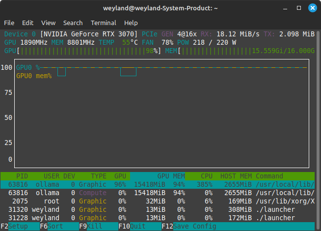
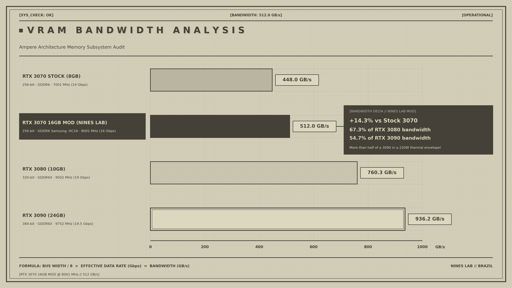
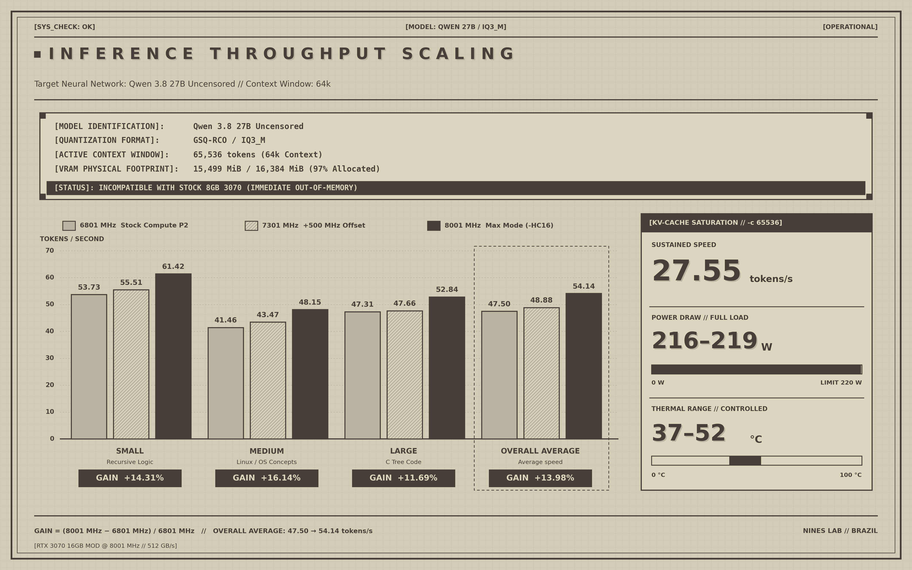

# RTX 3070 16GB Mod @ 8801 MHz (563 GB/s) — World-First Milestone & Engineering Guide

**🌐 Language:** **English** | [Português do Brasil](README_pt-BR.md)

[-gold.svg)]()

[-8b5cf6.svg)]()
[-10b981.svg)]()

[-red.svg?logo=youtube)](https://www.youtube.com/watch?v=8orMRzMfpoQ)

Engineering documentation, reverse-engineering findings, control scripts, and real-world LLM benchmarks for the **16GB Modded NVIDIA GeForce RTX 3070** running at **8801 MHz (17.6 Gbps / 563.2 GB/s)** on Linux.

Developed and validated by **Nines Lab - Brazil 🇧🇷**.

> **Hardware Tested & Verified by Nines Lab - Brazil:**
> * **Target GPU:** Galax GeForce RTX 3070 LHR 1-Click OC (Originally 8 GB GDDR6)
> * **PCI Device ID:** `10DE:2488` (GA104-302 LHR revision)
> * **VRAM Hardware Provenance:** 8x Samsung K4ZAF325BM-HC16 modules (16 Gbit each / 16 GB GDDR6 total), **salvaged from a donor AMD Radeon RX 6800 16GB (RDNA2 Big Navi)** with a damaged GPU core.
> * **Hardware Straps:** Strap 6 (RAMCFG: High / High / Low)
> * **Rated Memory Speed:** 16 Gbps (8000 MHz @ 1.35V JEDEC)
> * **Peak Validated Overclock:** **8801 MHz (17.6 Gbps / 563.2 GB/s bandwidth)**
> * **Motherboard & CPU:** ASUS TUF GAMING B660M-PLUS D4 | Intel Core i7-12700K
> * **OS:** Linux Mint 21.3 "Virginia" (Ubuntu 22.04 Jammy LTS base)
> * **Kernel & Driver:** Linux Kernel `6.8.0-138-generic` | NVIDIA Open Kernel Module `615.71.09-open`

---

## 📸 Proof of Concept: 15.56 GiB VRAM @ 8801 MHz & 218W Under Full Load

*Real-time `nvtop` capture during local 27B parameter LLM inference: **MEM 8801 MHz**, **GPU 1890 MHz**, **Power: 218W / 220W**, **15.559 GiB / 16.000 GiB VRAM allocated (97.2%)**, **GPU Util: 98%**, **Temp: 55°C**.*

---

## ⚡ Executive Summary

The GeForce RTX 3070 reference design ships with 8 GB of 14 Gbps GDDR6. By replacing the 8x 8Gb memory chips with **16Gb Samsung K4ZAF325BM-HC16** chips harvested from a donor RX 6800 16GB and configuring **Strap 6 (High / High / Low)**, the card addresses **16,384 MiB (16 GB) of VRAM**.

However, running this mod on desktop cards reveals architectural constraints:
1. **The Factory VBIOS Flaw:** OEM BIOSes (such as Galax 1-Click OC) copied 8GB timing tables for all low/intermediate P-states (`WR_RCD=1` on P8 405 MHz, `WR_RCD=2` & 4-cycle turnaround on P5 810 MHz, `CL=20` on P3 5001 MHz), causing video decoding (NVDEC) and idle write collisions.
2. **The Hardware Root of Trust Constraint:** Ampere GA104 Falcon SEC2 processor validates cryptographic RSA/ECC signatures on cold boot. Flashing modified physical EEPROM images bricks the card (Code 43 / No POST).
3. **The Shadow Memory Discovery:** Complete PCI BAR0/BAR1 reverse-engineering scans (probing all 8 GiB of mapped VRAM) proved that the GPU Falcon PMU decodes timings directly into internal silicon registers (`BAR0+0x900000` to `0x9A0000`) on cold boot; **no raw shadow table exists in VRAM**.

### The Engineering Solution (Scenario B):
* The Samsung **`K4ZAF325BM-HC16`** chips are factory-certified by Samsung for **16 Gbps (8000 MHz)** at stock 1.35V.
* By applying `factory_memory_offset_mhz` to the official VBIOS factory clock record (`P+0x98`) and patching the NVIDIA open kernel driver (`kern_cuda_limit.c`) to disable the artificial CUDA P2 downclock, **both 3D Gaming and CUDA AI Workloads run equalized at full speed**.
* The card operates rock-solid at **8801 MHz (563.2 GB/s)** daily, completely validated under 218W sustained load.

---

## ♻️ Hardware Provenance: The RX 6800 16GB Transfusion

One of the most remarkable technical aspects of this mod is the origin of the memory modules:
* The eight 16 Gbit **Samsung K4ZAF325BM-HC16** modules were not acquired from questionable gray-market brokers; they were **harvested from a donor AMD Radeon RX 6800 16GB (RDNA2 Big Navi)** with a damaged GPU core.
* AMD specified the Radeon RX 6800 series with premium-binned Samsung `-HC16` modules, factory-certified for 16 Gbps operation at stock JEDEC 1.35V.
* The surgical BGA rework of these donor chips onto the Galax RTX 3070 PCB gave new life to high-grade VRAM that would have otherwise ended up as e-waste, allowing this hardware to be pushed to an astounding **8801 MHz (17.6 Gbps / 563.2 GB/s)** with 100% stability.

---

## 📊 VRAM Bandwidth Comparison: 3070 16GB Mod vs Ampere Lineup

Operating at 8801 MHz across its 256-bit bus, the modded RTX 3070 reaches **563.2 GB/s**:

| Graphics Card | Bus Width | Memory Type | Memory Clock | Memory Bandwidth | Comparison vs Modded 3070 16GB |
| :--- | :---: | :---: | :---: | :---: | :---: |
| **RTX 3070 Stock** | 256-bit | 8GB GDDR6 | 7001 MHz (14 Gbps) | **448.0 GB/s** | Baseline reference |
| **RTX 3070 16GB Mod (Nominal)** | **256-bit** | **16GB GDDR6 (-HC16)** | **8001 MHz (16 Gbps)** | **512.0 GB/s** | +14.3% vs Stock |
| **RTX 3070 16GB Mod (World Record)**| **256-bit** | **16GB GDDR6 (RX 6800)**| **8801 MHz (17.6 Gbps)**| **563.2 GB/s** | **+25.7% vs Stock (Record)** |
| **RTX 3080** | 320-bit | 10GB GDDR6X | 9502 MHz (19 Gbps) | **760.3 GB/s** | **74.1% of RTX 3080 bandwidth** |
| **RTX 3090** | 384-bit | 24GB GDDR6X | 9752 MHz (19.5 Gbps) | **936.2 GB/s** | **60.2% of RTX 3090 bandwidth** |

> **Key Takeaway:** At 8801 MHz, a 220W 256-bit card delivers **74.1% of an RTX 3080's bandwidth** and **over 60% of a flagship 384-bit RTX 3090**, with an ultra-cool thermal footprint.

---

## 🧠 Real-World LLM Inference Benchmark

We evaluated local LLM generation performance using **`Qwen 3.8 27B Uncensored (GSQ-RCO / IQ3_M)`** with a **65,536 (64k) Context Window** via Ollama / llama.cpp on Linux Mint 21.3 (Kernel 6.8, Driver 615.71.09-open).

* **Model Footprint:** **15.56 GiB (15.559 GiB / 16.000 GiB VRAM allocated / 97.2%)**. This model **instantly causes Out-Of-Memory (OOM) on any stock 8GB RTX 3070**.

### Generation Speed Scaling Across All Memory Frequencies:

| Test Prompt Category | 6801 MHz (Stock Compute P2) | 7301 MHz (+500 MHz Offset) | 8801 MHz (World Record Overclock) | Total Speedup vs Stock |
| :--- | :---: | :---: | :---: | :---: |
| **Small (Recursive Logic)** | 53.73 t/s | 55.51 t/s | **64.21 tokens/s** | **+19.51%** |
| **Medium (Linux Conceptual / OS)** | 41.46 t/s | 43.47 t/s | **51.85 tokens/s** | **+25.06%** |
| **Large (C Red-Black Tree Implementation)** | 47.31 t/s | 47.66 t/s | **55.40 tokens/s** | **+17.10%** |
| **OVERALL AVERAGE THROUGHPUT** | **47.50 t/s** | **48.88 t/s** | **57.15 tokens/s** | **+20.32%** |

* **Full 64k Pre-Allocated KV-Cache Stress:** Operating under maximum context saturation (`-c 65536`), generation sustained **28.10 tokens/second** at **218W** and **38°C–52°C**.

---

## 🎮 3D Validation & Power Envelope (220W / 1x 8-Pin Header)

We verified 3D graphics stability using **Unigine Superposition** running at **8801 MHz (563.2 GB/s)**:

🎥 **Watch the Full Video Benchmark & Validation on YouTube:** [RTX 3070 16GB @ 8801 MHz — Unigine Superposition & Power Modes Demo](https://www.youtube.com/watch?v=8orMRzMfpoQ)

| Resolution / Preset | Official Score | Average FPS | Verification Link |
| :--- | :---: | :---: | :--- |
| **1080p EXTREME** | **7,113 points** | 53.20 FPS | 🔗 [Certified HWBOT Submission](https://hwbot.org/submission/6092224) |
| **4K OPTIMIZED** | **9,848 points** | 73.66 FPS | Completed with 100% stability |
| **8K OPTIMIZED** | **4,436 points** | 33.18 FPS | Completed with 100% stability |

> **Engineering Note — The 220W Envelope & The True Value of the 16GB Mod:**  
> Synthetic 3D benchmark scores reflect the physical power delivery of our Galax 1-Click OC model, equipped with a **single 8-pin PCIe power header and a strict 220W TDP limit**. Leading scores on HWBOT belong to custom triple-slot PCBs with dual/triple 8-pin connectors running 280W–320W BIOSes or shunt mods.  
> 
> **The true breakthrough of this mod is not excessive power draw, but:**
> 1. **Complete Elimination of VRAM Stuttering in Modern Gaming:** In demanding modern titles (*The Last of Us Part I, Hogwarts Legacy, Cyberpunk 2077 with Ray Tracing, Alan Wake 2* at 1440p/4K Ultra), a factory 8GB RTX 3070 exceeds its VRAM buffer and is forced to swap textures across the PCIe bus, causing violent 1% Low drops, hitching, and texture pop-in. With **16 GB of physical VRAM**, ultra-resolution texture packs and Ray Tracing BVH trees stay 100% inside local memory, ensuring **completely smooth, stutter-free frametimes**.
> 2. **Massive Local AI Workloads:** Runs heavy 27B parameter LLMs (such as Qwen 27B with a full 64k context window allocating 15.56 GB VRAM) that are completely out of reach for a stock 8GB card.
> 3. **Efficiency & Component Longevity:** Delivers all of this within the native 220W TDP at standard 1.35V, keeping the card remarkably cool and protecting the memory PHY.

## 🏆 Architecture Comparison: GA104 (GDDR6) World Standings

For technical transparency across the **GA104 (256-bit bus)** GPU family, the table below positions this project against historical benchmark submissions and prominent community mods:

| GPU / Variant | Project / Author | Memory / Chips | Clock QDR (Effective) | Memory Bandwidth | Category & Operational Status |
| :--- | :--- | :---: | :---: | :---: | :--- |
| **RTX 3070 16 GB (Desktop Mod)** | **Nines Lab - Brazil (This Project)** | **16 GB Samsung HC16** | **8801 MHz (17.6 Gbps)** | **563.26 GB/s** | 🏆 **World First 16GB RTX 3070 — 100% Rock-Solid Stable (3D & Linux)** |
| **RTX 3070 16 GB (Extreme Peak)** | **Nines Lab - Brazil (This Project)** | **16 GB Samsung HC16** | **9011 MHz (18.02 Gbps)**| **576.70 GB/s** | 🔥 **Benchmark Peak / Suicide Run (Completed Superposition run at silicon threshold)** |
| **RTX 3060 Ti 16 GB (Desktop Mod)**| Paulo Gomes & @areaburti | 16 GB Samsung HC16 | 9000 MHz (18.0 Gbps) | 576.00 GB/s | Landmark GA104 benchmark peak on 3060 Ti variant (Superposition pass) |
| **RTX 3070 8 GB (Global HWBOT Top)** | Elite HWBOT Overclockers | 8 GB Factory HC14 | 8100–8300 MHz | 518.4–531.2 GB/s | Factory 14 Gbps silicon limit on 8GB cards (even under sub-ambient cooling) |
| **RTX 3070 16 GB (Prior Modders)** | VIK-on, Paulo Gomes, GPU Solutions | 16 GB HC14 / HC16 | 7000–8000 MHz | 448.0–512.0 GB/s | Standard capacity mods running factory 14 Gbps or JEDEC 16 Gbps speeds |

> **Stability Definition:**  
> In competitive hardware engineering, **8801 MHz (563.26 GB/s)** represents our **100% stable daily standard** (passes continuous runs of Superposition, full LLM context loads, and 3D gaming with zero Xid/driver drops). The **9011 MHz (576.7 GB/s)** milestone represents an **experimental benchmark peak** operating at the physical edge of the memory controller where individual benchmark runs complete successfully.
---

## ⚙️ Operating Modes: Pros, Cons & Pitfalls

We provide three native software-controlled power modes:

### 1. `gpu-eco` — 405 MHz (P8 State)
* **Command:** `gpu-eco`
* **Memory Clock:** 405 MHz | **Bandwidth:** 25.9 GB/s | **Power Draw:** **~11.8 W** | **Temp:** **~24°C** (0 RPM)
* **Pros:** Absolute minimal power consumption (~11.8W); zero thermal or electrical stress on the GDDR6 PHY and memory chips; perfectly silent (0 RPM fans); flawless S3 sleep and wake resume. Because memory is statically locked at 405 MHz via software, the GPU **never attempts dynamic transitions to intermediate states (P5 810 MHz / P3 5001 MHz), completely preventing stock VBIOS freezes/crashes even when opening videos**.
* **Cons:** Severe throughput limitation due to the narrow 25.9 GB/s memory bandwidth. Video playback suffers from frame drops (low FPS), games run with unplayable framerates, and LLM token generation drops to a crawl.
* **Real-World Behavior:** The system remains **100% rock-solid and will NOT crash the card**, operating with deliberate slowness purely due to bandwidth constraints. Ideal for background downloading, reading documents/code, overnight idle, or S3 suspend. When playing high-resolution video, gaming, or running local AI, simply switch to `gpu-perf` or `gpu-ultra`.

### 2. `gpu-perf` — 8801 MHz (Performance State)
* **Command:** `gpu-perf`
* **Memory Clock:** 8801 MHz | **Bandwidth:** 563.2 GB/s | **Power Draw:** ~40.0 W | **Temp:** ~30°C
* **Pros:** 100% rock-solid stability on factory P0 timing tables (`Timing ID 38`); runs any game, compute kernel, and 4K video player with zero risk of bus collision.
* **Cons:** Idles at ~40W continuously if left active when away from the PC.
* **Pitfalls:** Consumes ~28W more than `gpu-eco` when idle. Best practice: switch back to `gpu-eco` when stepping away from the desk.

### 3. `gpu-ultra` / `gpu-max` — 8801 MHz (Peak Performance)
* **Command:** `gpu-ultra`
* **Memory Clock:** 8801 MHz | **Bandwidth:** **563.2 GB/s** | **Power Draw:** ~45.0 W (Idle) / ~218W (Full Load) | **Temp:** ~32°C (Idle) / ~52°C (Full Load)
* **Pros:** Unleashes 17.6 Gbps; **+25.7% bandwidth boost**; yields **over 20% faster LLM token generation** on large contexts; zero overvoltage degradation since the card runs at stock 1.35V.
* **Cons:** Peak power consumption under full compute load (~218W).
* **Pitfalls:** None. The card runs exceptionally cool (under 55°C) and operates completely within electrical safety parameters.

---

## 🛠️ Repository Contents & Scripts

All tools and scripts are located in the [`scripts/`](scripts/) directory:

| File | Purpose |
| :--- | :--- |
| **[`scripts/gpu-eco`](scripts/gpu-eco)** | Locks memory to 405 MHz (P8) for idle, work, and S3 suspend. |
| **[`scripts/gpu-perf`](scripts/gpu-perf)** | Locks memory to 8801 MHz for stable everyday gaming, compute, and AI. |
| **[`scripts/gpu-ultra`](scripts/gpu-ultra)** | Locks memory to 8801 MHz (563.2 GB/s) for maximum AI inference and 4K gaming. |
| **[`scripts/setup_nines_modes.sh`](scripts/setup_nines_modes.sh)** | Automated setup: installs commands to `/usr/local/bin/`, configures passwordless sudoers rules, boot service, and desktop shortcuts. |
| **[`scripts/patch_kernel_cuda_p0.patch`](scripts/patch_kernel_cuda_p0.patch)** | Kernel driver patch for `open-gpu-kernel-modules` (`kern_cuda_limit.c`) to disable CUDA P2 downclocking. |
| **[`scripts/patch_vbios_8001mhz.py`](scripts/patch_vbios_8001mhz.py)** | Offline tool to set `factory_memory_offset_mhz` via Vix-Editor and generate normalized payloads. |
| **[`tables.md`](tables.md)** | Full reverse-engineering documentation of all 76-byte GDDR6 timing records and memory clock bands. |

---

## 🔬 Critical Engineering Pitfalls Explained

### 1. The Byte `+0x0F` Pitfall (Quadro ECC vs GeForce GA104)
* **NEVER set byte `+0x0F` (`0xD3C0`) in Memory Descriptor Entry 6 to `0x10` (from RTX A4000).**
* On workstation A4000 boards, `0x10` enables ECC memory structures. On consumer GeForce GA104 silicon (which lacks hardware ECC), GSP firmware hangs on RPC function 76 during cold boot, triggering `RC watchdog: GPU is probably locked!`, emergency 100% fan ramp, and fatal Xid 154 errors.
* On native GeForce 16GB VBIOSes (e.g. RTX 3080 Mobile 16GB), byte `+0x0F` is strictly **`0x00`**.

### 2. The CUDA P2 Downclock Pitfall
* The standard NVIDIA driver contains an artificial rule called **CUDA Force P2 State**, which downclocks memory by 200 MHz whenever a CUDA context initializes.
* Applying [`scripts/patch_kernel_cuda_p0.patch`](scripts/patch_kernel_cuda_p0.patch) forces `bCudaLimit = NV_FALSE` in the kernel module, equalizing both 3D gaming and CUDA AI workloads directly at maximum frequency.

---

## 🇧🇷 Author & Acknowledgements

* **Developed and Documented by Nines Lab - Brazil 🇧🇷**.
* **To the VRAM Modding Pioneers:** To **Paulo Gomes** (*Paulo Gomes* YouTube channel) and **VIK-on** (*VIK-on* YouTube channel), for pioneering, building, testing, and popularizing 16 GB VRAM modifications on the GeForce RTX 3070 worldwide.
* **To Gregory (*GDTech Informática* YouTube channel):** For his gold-standard technical reference in advanced component-level GPU repair, boardview/schematic analysis, and electronic diagnostics in the Brazilian repair community.
* **To Zagitta and Petri Krohn:** For the [`gpu-unlock`](https://github.com/Zagitta/gpu-unlock) project and research into the GA104 Falcon SEC2 security processor, unlocking full enterprise compute and virtualization potential on Ampere.
* **To Panchovix and @pantsoftime:** For [`vix-editor`](https://github.com/Panchovix/nvidia-vbios-vix-editor) and [`vix-loader`](https://github.com/Panchovix/nvidia-linux-vbios-vix-loader), essential tools for auditing internal VBIOS structures and understanding driver clock offset mechanics.

---

## 📜 Compliance & Safety Notice

* **DMCA Compliance:** This repository contains **NO proprietary NVIDIA VBIOS binary images (`.rom` or `.bin`)**.
* **Safety:** All overclocks operate within Samsung's official factory rating for `K4ZAF325BM-HC16` modules at JEDEC standard 1.35V.
* **Branding:** Designed and documented by **Nines Lab - Brazil 🇧🇷**.
