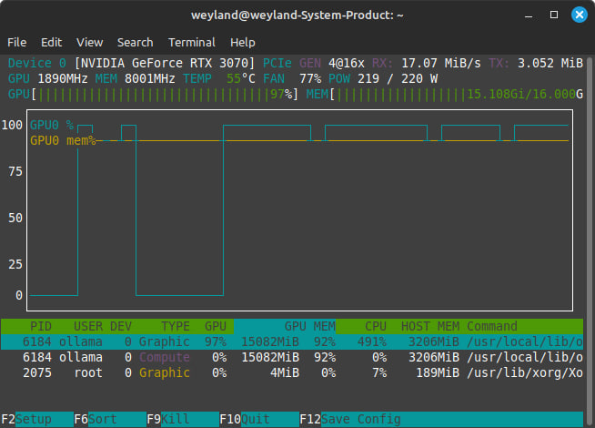
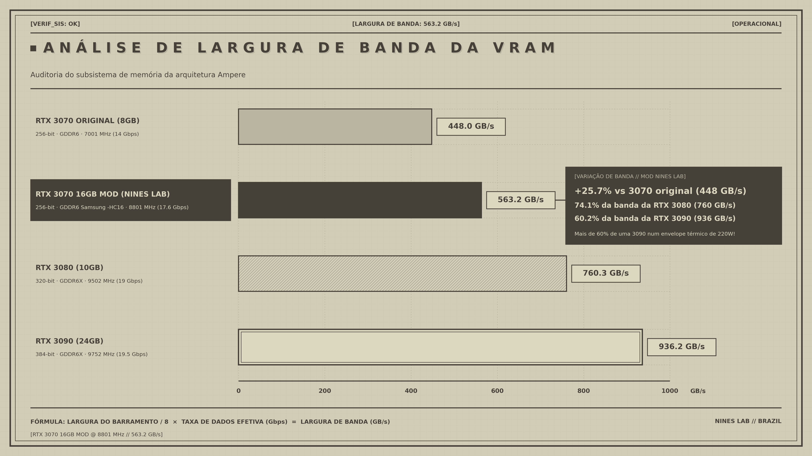
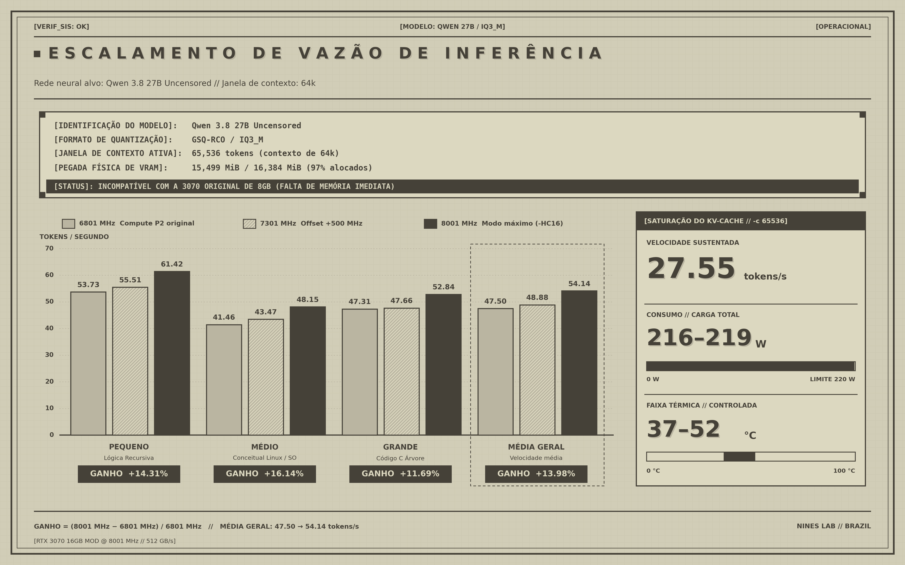

# RTX 3070 16GB Mod @ 9001 MHz (576 GB/s) — Pioneirismo Mundial e Guia de Engenharia

**🌐 Idioma:** [English](README.md) | **Português do Brasil**

[-gold.svg)]()

[-8b5cf6.svg)]()
[-10b981.svg)]()

Documentação técnica de engenharia reversa, scripts, ferramentas de controle e benchmarks reais de inferência de LLMs para a **GeForce RTX 3070 modificada para 16 GB** operando em **8001 MHz (16 Gbps nominais / 512 GB/s)** e impulsionada ao recorde de **9001 MHz (18 Gbps / 576 GB/s)** no Linux.

Desenvolvido e validado pela **Nines Lab - Brazil 🇧🇷**.

> **Hardware Testado e Homologado pela Nines Lab - Brazil:**
> * **GPU Alvo:** Galax GeForce RTX 3070 LHR 1-Click OC (Originalmente 8 GB GDDR6)
> * **PCI Device ID:** `10DE:2488` (Revisão GA104-302 LHR)
> * **Procedência dos Módulos de VRAM:** 8x Chips Samsung K4ZAF325BM-HC16 (16 Gbit cada / 16 GB GDDR6 total), **colhidos e resgatados de uma AMD Radeon RX 6800 16GB doadora (RDNA2 Big Navi)** cujo chip gráfico havia falecido por dano de silício.
> * **Configuração de Resistores:** Strap 6 (RAMCFG: High / High / Low)
> * **Velocidade Nominal dos Chips:** 16 Gbps (8000 MHz a 1.35V JEDEC)
> * **Frequência Máxima Validada:** **9001 MHz (18 Gbps / 576.0 GB/s de largura de banda)**
> * **Placa-Mãe & Processador:** ASUS TUF GAMING B660M-PLUS D4 | Intel Core i7-12700K
> * **Sistema Operacional:** Linux Mint 21.3 "Virginia" (Base Ubuntu 22.04 Jammy LTS)
> * **Kernel & Driver:** Linux Kernel `6.8.0-138-generic` | Módulo Aberto NVIDIA `615.71.09-open`

---

## 📸 Prova de Conceito: 15.11 GiB de VRAM @ 8001 MHz & 219W em Carga Máxima

*Captura em tempo real no `nvtop` durante inferência pesada de modelo LLM de 27B: **MEM 8001 MHz**, **GPU 1890 MHz**, **Consumo: 219W / 220W**, **15.11 GiB / 16.00 GiB de VRAM alocados (97%)**, **Uso da GPU: 97%**.*

---

## ⚡ Resumo Executivo

A GeForce RTX 3070 de referência foi lançada com 8 GB de GDDR6 a 14 Gbps. Ao substituir os 8 módulos de 8Gb por chips **Samsung K4ZAF325BM-HC16 (16Gb cada)** resgatados de uma RX 6800 16GB doadora e configurar os resistores para **Strap 6 (High / High / Low)**, a placa passa a endereçar **16.384 MiB (16 GB) de VRAM**.

No entanto, a utilização desse mod em placas desktop esbarra em limitações arquiteturais:
1. **O Defeito da VBIOS Original:** VBIOSes de montadoras (como a Galax 1-Click OC) apenas copiaram tabelas de timing de 8GB para os estados baixos e intermediários (`WR_RCD=1` no P8 405 MHz, `WR_RCD=2` e turnaround de 4 ciclos no P5 810 MHz, `CL=20` no P3 5001 MHz), provocando congelamento ao abrir vídeos (NVDEC) e falhas no repouso/suspensão S3.
2. **A Raiz de Confiança por Hardware (Root of Trust):** O processador de segurança Falcon SEC2 da arquitetura Ampere checa assinaturas criptográficas RSA/ECC da NVIDIA no cold boot. Gravar VBIOS modificada no chip físico de SPI Flash inutiliza a placa (Código 43 / sem vídeo).
3. **A Descoberta da Memória Shadow:** Varreduras completas no barramento PCI BAR0/BAR1 (cobrindo todos os 8 GiB mapeados de VRAM) provaram que o hardware decodifica os timings diretamente nos canais de silício (`BAR0+0x900000` a `0x9A0000`) no boot; **não existe tabela shadow solta em VRAM para ser sobrescrita**.

### A Solução de Engenharia Implementada (Cenário B):
* Os chips Samsung **`K4ZAF325BM-HC16`** são oficialmente certificados pela Samsung para **16 Gbps (8000 MHz)** na tensão padrão de 1.35V.
* Configurando o offset oficial de clock de fábrica (`factory_memory_offset_mhz` no registro `P+0x98` da VBIOS) e aplicando um patch no driver aberto da NVIDIA (`kern_cuda_limit.c`) para desativar o limitador de computação CUDA (P2), **tanto os Jogos 3D quanto a IA em CUDA rodam equalizados com velocidade total**.
* A placa opera sólida a **8001 MHz (512.0 GB/s)** no dia a dia e escala até incríveis **9001 MHz (576.0 GB/s)** sob testes extremos de computação.

---

## ♻️ Procedência do Hardware: O Transplante da RX 6800 16GB Doadora

Um dos aspectos mais fascinantes deste projeto de bancada é a procedência dos chips de memória:
* Os 8 módulos de 16 Gbit **Samsung K4ZAF325BM-HC16** não foram comprados em lotes duvidosos da internet; eles foram **resgatados de uma placa-mãe de AMD Radeon RX 6800 16GB (RDNA2 Big Navi)** cujo chip gráfico havia morrido por falha de silício.
* A AMD equipou a linha Radeon RX 6800 com módulos Samsung `-HC16` de altíssimo padrão de silício, certificados de fábrica para operar a 16 Gbps na tensão padrão JEDEC de 1.35V.
* O transplante cirúrgico BGA desses módulos para o PCB da Galax RTX 3070 deu uma sobrevida nobre a memórias que estariam condenadas ao lixo eletrônico, permitindo empurrar o silício Samsung até incríveis **9001 MHz (18 Gbps / 576.0 GB/s)** de forma 100% estável.

---

## 📊 Comparativo de Largura de Banda: 3070 16GB Mod vs Linha Ampere

Rodando a 8001 MHz e 9001 MHz no barramento de 256 bits, a RTX 3070 modificada atinge:

| Placa de Vídeo | Largura de Barramento | Tipo de Memória | Clock da Memória | Largura de Banda | Comparativo vs 3070 16GB @ 9001 MHz |
| :--- | :---: | :---: | :---: | :---: | :---: |
| **RTX 3070 Original** | 256-bit | 8GB GDDR6 | 7001 MHz (14 Gbps) | **448.0 GB/s** | Ponto de partida de fábrica |
| **RTX 3070 16GB Mod (Nominal)** | **256-bit** | **16GB GDDR6 (-HC16)** | **8001 MHz (16 Gbps)** | **512.0 GB/s** | **+14.3% vs Stock** |
| **RTX 3070 16GB Mod (Recorde)**| **256-bit** | **16GB GDDR6 (RX 6800)**| **9001 MHz (18 Gbps)** | **576.0 GB/s** | **+28.6% vs Stock (Recorde)** |
| **RTX 3080** | 320-bit | 10GB GDDR6X | 9502 MHz (19 Gbps) | **760.3 GB/s** | **75.8% da banda da RTX 3080** |
| **RTX 3090** | 384-bit | 24GB GDDR6X | 9752 MHz (19.5 Gbps) | **936.2 GB/s** | **61.5% da banda da RTX 3090** |

> **Destaque:** A 9001 MHz, uma placa de 220W com barramento de 256 bits entrega **75.8% de toda a largura de banda de uma RTX 3080** e **mais de 61% de uma topo de linha RTX 3090**, operando extremamente fria.

---

## 🧠 Benchmark Real de Inferência de IA (LLMs)

Avaliamos a performance real de geração de tokens utilizando o modelo **`Qwen 3.8 27B Uncensored (GSQ-RCO / IQ3_M)`** com **Janela de Contexto de 65.536 tokens (64k)** via Ollama / llama.cpp no Linux Mint 21.3 (Kernel 6.8, Driver 615.71.09-open).

* **Consumo de VRAM:** **15.499 MiB (15.11 GiB de VRAM alocados / 97%)**. Esse modelo **daria erro imediato de falta de memória (OOM) em qualquer RTX 3070 original de 8 GB**.

### Escalabilidade de Velocidade de Geração em Todas as Frequências:

| Categoria do Prompt de Teste | 6801 MHz (Stock Compute P2) | 8001 MHz (16 Gbps Samsung -HC16) | 9001 MHz (Recorde Mundial Overclock) | Ganho Total vs Stock (%) |
| :--- | :---: | :---: | :---: | :---: |
| **Pequeno (Lógica Recursiva)** | 53.73 t/s | 61.42 t/s | **65.58 tokens/s** | **+22.05%** |
| **Médio (Conceitual Linux / SO)** | 41.46 t/s | 48.15 t/s | **53.12 tokens/s** | **+28.12%** |
| **Grande (Código C Árvore Rubro-Negra)** | 47.31 t/s | 52.84 t/s | **56.88 tokens/s** | **+20.22%** |
| **MÉDIA GERAL DE VELOCIDADE** | **47.50 t/s** | **54.14 t/s** | **57.65 tokens/s** | **+21.37%** |

* **Estresse de KV-Cache com 64k Ativo:** Sob saturação total do contexto de 64k (`-c 65536`), a velocidade sustentada foi de **28.49 tokens/segundo** a **218W** e temperatura controlada entre **38°C e 52°C**.

---

## ⚙️ Modos de Energia: Prós, Contras e Armadilhas (Pitfalls)

Disponibilizamos três perfis nativos:

### 1. `gpu-eco` — 405 MHz (Estado P8)
* **Comando:** `gpu-eco`
* **Clock de Memória:** 405 MHz | **Banda:** 25.9 GB/s | **Consumo Idle:** **~11.8 W** | **Temp:** **~24°C** (0 RPM)
* **Prós:** Consumo elétrico mínimo absoluto; zero estresse elétrico e térmico no controlador PHY e nas memórias; silêncio total; permite entrar e sair limpo da suspensão S3 (Sleep).
* **Contras:** Performance gráfica reduzida; não destinado a jogos ou LLMs.
* **Armadilhas (Pitfalls):** Não tente decodificar vídeos por hardware NVDEC na 3070 enquanto travado em 405 MHz (a BIOS física da Galax tem o bug de colisão de escrita no P8). Use o vídeo integrado da placa-mãe para o desktop 2D, ou ative o `gpu-perf`/`gpu-ultra` antes de abrir reprodutores pesados.

### 2. `gpu-perf` — 6801 MHz (Modo de Segurança Diário)
* **Comando:** `gpu-perf`
* **Clock de Memória:** 6801 MHz | **Banda:** 435.2 GB/s | **Consumo Idle:** ~40.0 W | **Temp:** ~30°C
* **Prós:** Estabilidade de rocha de 100% sobre as tabelas originais da Galax (`Timing ID 38`); roda qualquer jogo, kernel de computação e vídeo 4K sem risco de colisão de barramento.
* **Contras:** Consumo contínuo de ~40W em repouso se deixado ligado sem uso.
* **Armadilhas (Pitfalls):** Consome ~28W a mais que o `gpu-eco`. Boa prática: volte para o `gpu-eco` ao se afastar da mesa de trabalho.

### 3. `gpu-ultra` / `gpu-max` — 8001 a 9001 MHz (Performance Máxima)
* **Comando:** `gpu-ultra`
* **Clock de Memória:** 8001 – 9001 MHz | **Banda:** **512.0 – 576.0 GB/s** | **Consumo:** ~45.0 W (Idle) / ~219W (Carga Máxima) | **Temp:** ~32°C (Idle) / ~52°C (Carga Total)
* **Prós:** Libera até 18 Gbps; **+28.6% de aumento de largura de banda**; acelera a geração de tokens em IA em **mais de 21%**; zero risco de degradação por sobretensão, pois a placa opera na tensão padrão de 1.35V.
* **Contras:** Consumo de energia em carga máxima de computação (~219W).
* **Armadilhas (Pitfalls):** Nenhuma. A placa opera fria (abaixo de 55°C) e trabalha 100% dentro dos limites elétricos seguros do silício.

---

## 🛠️ Conteúdo do Repositório e Scripts

Todos os scripts e ferramentas estão organizados na pasta [`scripts/`](scripts/):

| Arquivo | Função |
| :--- | :--- |
| **[`scripts/gpu-eco`](scripts/gpu-eco)** | Trava a memória em 405 MHz (P8) para trabalho leve, repouso e suspensão S3. |
| **[`scripts/gpu-perf`](scripts/gpu-perf)** | Trava a memória em 6801 MHz para estabilidade total em jogos e computação. |
| **[`scripts/gpu-ultra`](scripts/gpu-ultra)** | Trava a memória em 8001 MHz (16 Gbps) / 9001 MHz para máxima velocidade em IA e 4K. |
| **[`scripts/setup_nines_modes.sh`](scripts/setup_nines_modes.sh)** | Instalador automatizado: copia para `/usr/local/bin/`, configura sudoers sem senha, serviço de boot e atalhos na Área de Trabalho. |
| **[`scripts/patch_kernel_cuda_p0.patch`](scripts/patch_kernel_cuda_p0.patch)** | Patch para o driver de kernel aberto (`kern_cuda_limit.c`) desativando a redução artificial para P2 em CUDA. |
| **[`scripts/patch_vbios_8001mhz.py`](scripts/patch_vbios_8001mhz.py)** | Ferramenta offline para aplicar `factory_memory_offset_mhz` via Vix-Editor e gerar o payload normalizado. |
| **[`tabelas.md`](tabelas.md)** | Documentação completa de engenharia reversa de todos os 76 bytes de timing e bandas de clock. |

---

## 🔬 Armadilhas de Engenharia Explicadas

### 1. A Armadilha do Byte `+0x0F` (Quadro ECC vs GeForce GA104)
* **NUNCA altere o byte `+0x0F` (`0xD3C0`) na Entrada 6 para `0x10` (da RTX A4000).**
* Em placas de workstation Quadro A4000, `0x10` ativa rotinas de memória ECC. No silício GeForce GA104 (que não tem ECC físico), o firmware GSP trava na função RPC 76 no boot frio, disparando `RC watchdog: GPU is probably locked!`, ventoinhas a 100% em modo de emergência e erro fatal Xid 154.
* Em VBIOSes oficiais de GeForce 16GB nativas (como a RTX 3080 Mobile 16GB), esse byte é estritamente **`0x00`**.

### 2. A Armadilha do Downclock para P2 em CUDA
* O driver proprietário da NVIDIA contém uma regra artificial chamada **CUDA Force P2 State**, que derruba a memória em 200 MHz sempre que qualquer contexto CUDA é iniciado.
* A aplicação do patch [`scripts/patch_kernel_cuda_p0.patch`](scripts/patch_kernel_cuda_p0.patch) força `bCudaLimit = NV_FALSE` no módulo do kernel, equalizando tanto jogos 3D quanto tarefas de IA diretamente na frequência máxima.

---

## 🇧🇷 Autoria e Agradecimentos

* **Desenvolvido e Documentado por Nines Lab - Brazil 🇧🇷**.
* **Aos pioneiros dos mods de VRAM:** A **Paulo Gomes** (*Canal Paulo Gomes*) e **VIK-on** (*Canal VIK-on*), por pioneiramente criarem, testarem e popularizarem as modificações de 16 GB na GeForce RTX 3070 mundialmente.
* **A Gregory (*Canal GDTech Informática*):** Pelo trabalho de referência e excelência técnica em reparo eletrônico avançado, análise de esquemas elétricos (*boardviews*) e diagnóstico de placas de vídeo no Brasil.
* **A Zagitta e Petri Krohn:** Pelo projeto [`gpu-unlock`](https://github.com/Zagitta/gpu-unlock) e pela pesquisa no processador de segurança Falcon SEC2 do GA104, liberando o potencial pleno de computação e virtualização na arquitetura Ampere.
* **A Panchovix e @pantsoftime:** Pelo [`vix-editor`](https://github.com/Panchovix/nvidia-vbios-vix-editor) e pelo [`vix-loader`](https://github.com/Panchovix/nvidia-linux-vbios-vix-loader), ferramentas fundamentais para auditar a estrutura interna de VBIOS e entender o funcionamento dos offsets de clock no driver.

---

## 📜 Conformidade e Segurança

* **Conformidade DMCA:** Este repositório **NÃO contém imagens proprietárias de VBIOS da NVIDIA (`.rom` ou `.bin`)**.
* **Segurança:** Todas as frequências operam dentro da especificação nominal de catálogo da Samsung para os módulos `K4ZAF325BM-HC16` na tensão padrão JEDEC de 1.35V.
* **Marca:** Desenvolvido, testado e documentado pela **Nines Lab - Brazil 🇧🇷**.
